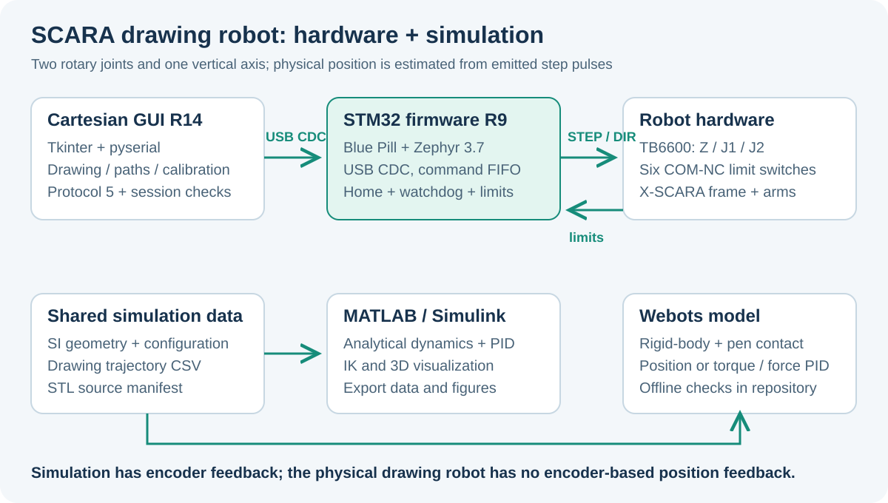
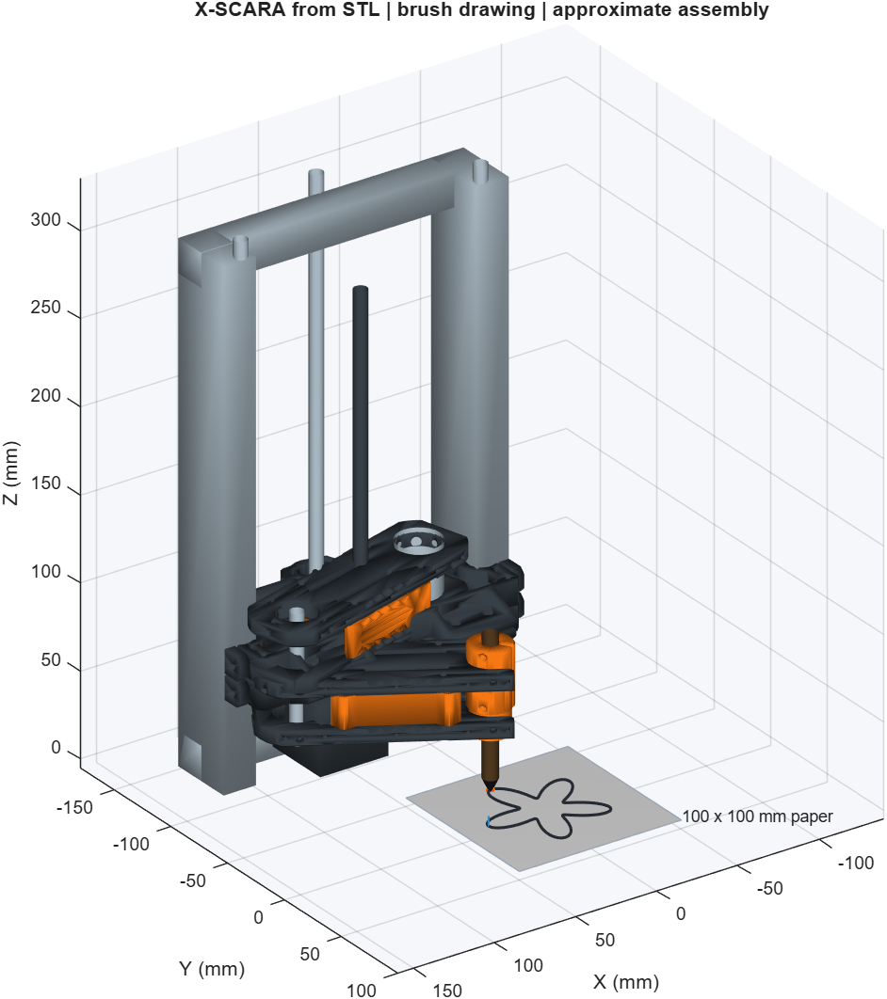

# SCARA Drawing Robot

A 2R + Z pen-drawing robot with STM32/Zephyr firmware, a Python Cartesian GUI, and MATLAB/Simulink + Webots models.

Robot vẽ 2R + Z với firmware STM32/Zephyr, GUI Đề-các Python và mô hình MATLAB/Simulink + Webots.

[English](#english) | [Tiếng Việt](#tieng-viet)

<p align="center">
  
  
</p>

The checked-in drawing demo is shown at 2x speed. [Original video](media/drawing-demo.mp4) | [Side view](media/robot-side-1.jpg) | [Driver reference photo](media/tb6600-driver.jpg).

Demo vẽ lưu trong repo được phát ở tốc độ 2x. [Video gốc](media/drawing-demo.mp4) | [Ảnh mặt bên](media/robot-side-1.jpg) | [Ảnh tham chiếu driver](media/tb6600-driver.jpg).



<a id="english"></a>

## English

This HPMR course project (HK261) controls a SCARA robot that draws shapes and text on paper. Two rotary joints position the pen in XY and a vertical lead-screw axis raises or lowers the arm assembly. The PC performs kinematics and path planning; the STM32 emits coordinated step pulses and handles homing, limits, and communication faults.

This README describes **`main`: GUI R14 / firmware R9**. GUI R15 development is on
[branch `codex/scara-r15-upgrade-20261017`](https://github.com/TuanLinh05/SCARA-Robot/tree/codex/scara-r15-upgrade-20261017).

**The frame and arm mechanics originate from [madl3x/X-SCARA](https://github.com/madl3x/x-scara/tree/master), GPL-3.0.** The STL files, mechanical BOMs, and assembly images in `Hardware/arm`, `Hardware/frame`, and `Hardware/3D Print` retain that attribution. This project's additions include firmware, GUI, simulation, and a Deli EG118 pen holder fitted to the reference geometry.

### Current components

| Component | Current version / role |
| --- | --- |
| Physical controller | STM32F103C8 Blue Pill, USB CDC, Zephyr 3.7 |
| Firmware | `SCARA_CART_NC_HOME_V5_R9`, protocol 5 |
| Desktop GUI | R14, Python 3.12 + Tkinter + pyserial |
| Stepper system | Three NEMA 17 motors and TB6600 STEP/DIR drivers |
| Homing | Six COM-NC limit switches, two per axis |
| Mechanical defaults | L1/L2 98 mm, Z lead 2 mm/revolution, configured microsteps Z/J1/J2 = 16/8/8 |
| Simulation | Analytical MATLAB/Simulink model and a separate Webots rigid-body model |

Mechanical numbers are **configuration defaults**, not measurements of every assembled robot. The real robot has no encoder-based position feedback. Its displayed Cartesian position is derived from the firmware's emitted pulse counts.

### What the system does

- Cartesian jogging, forward/inverse kinematics, reach checking, mechanical-model editing, and test point sequences.
- Shape/text library including BK, LINH, THOA, flower, star, heart, circle, ellipse, square, triangle, and rhombus.
- Whole-stroke preflight before uploading `PATH` / `SEG` / `GO` commands to a 32-segment firmware FIFO.
- Coordinated three-axis DDA step generation using a 1 MHz TIM2 timebase and fixed-point velocity profiles. The timebase is not a 1 MHz motor step rate.
- HOME/CALIB sweeps and a measured elbow-coupling probe; GPIO checks, soft limits, USB/heartbeat monitoring, and buffer-underrun handling.
- JSONL session logging and offline drawing audits.
- A `--demo` GUI mode that uses a simulated link without opening a real COM port.

### Repository map

| Path | Contents |
| --- | --- |
| [Firmware/ScaraCartesian](Firmware/ScaraCartesian) | Active Zephyr source, host tests, build tools, and supplied HEX/BIN |
| [Firmware/Ref](Firmware/Ref) | Original STM32CubeIDE/HAL project retained as reference |
| [Software/src](Software/src) | GUI, kinematic model, protocol, path planning, shapes, logs, audits |
| [Software/tests](Software/tests) | Python tests and GUI smoke checks using simulated ports |
| [Software/packaging](Software/packaging) | R14 PyInstaller specification |
| [Simulation/common](Simulation/common) | Shared SI parameters, CSV trajectories, converted meshes, provenance |
| [Simulation/matlab](Simulation/matlab) | MATLAB app, dynamics/control modules, editable Simulink model |
| [Simulation/webots](Simulation/webots) | World, PROTOs, Python controller, builder, offline checks |
| [Hardware](Hardware) | X-SCARA print files/BOMs/assembly images and EG118 holder |
| [Doc](Doc) | Firmware review and discussion of drawing errors |
| [media](media) | Photos and drawing demonstration of the physical robot |

### Try the GUI without hardware

From the repository root on Windows, with Python 3.12 and Tkinter available:

```powershell
git clone https://github.com/TuanLinh05/SCARA-Robot.git
cd SCARA-Robot
py -3.12 -m pip install -r Software\requirements.txt
py -3.12 Software\src\cartesian_nc_control.py --demo
```

The runtime requirement file pins `pyserial==3.5`; Tkinter is part of the Python environment. Demo mode lets you inspect the GUI flow without serial hardware, but it does not validate motor behavior or drawing accuracy.

For the physical connection, omit `--demo`:

```powershell
py -3.12 Software\src\cartesian_nc_control.py
```

Alternatively, `Software/Run_Cartesian_GUI.bat` uses an existing R14 EXE if present, otherwise tries a configured Zephyr Python environment and then `py -3`. A fresh clone does not include `Software/dist`.

To package the GUI from the root:

```powershell
.\Software\Build_Cartesian_NC_GUI.ps1 -Python python
```

The script can install its build dependencies into `Software/.packaging` and produces `Software/dist/SCARA_Cartesian_NC_v5_R14`. Keep the EXE and its `_internal` directory together. See [Software/README.md](Software/README.md) for configuration/log locations and the module organization.

### Wiring

The TB6600 input arrangement is common-cathode: **PUL-, DIR-, and ENA- connect to shared GND**. Check the actual driver's input characteristics and current/microstep settings against your board and motors.

| Axis | PUL+ | DIR+ | ENA+ | DIR HIGH-end switch | DIR LOW-end switch |
| --- | --- | --- | --- | --- | --- |
| Z | PA0 | PA1 | PA2 | PA3, top | PA4, bottom |
| J1 | PA8 | PB15 | PB14 | PB0 | PB1 |
| J2 | PA6 | PA7 | PB13 | PB10 | PB11 |

The [Zephyr overlay](Firmware/ScaraCartesian/app.overlay) configures ENA outputs active LOW. Switches use **COM -> GND, NC -> GPIO**, with internal 3.3 V pull-ups; NO is unused. Normal closed wiring reads LOW, while an actuated switch or open wire reads HIGH.

USB CDC uses the Blue Pill's micro-USB port: PA11 D-, PA12 D+. The GUI opens the virtual COM port at the configured 115200 baud; no separate USB-UART console is used by the active firmware.

Assembly resources: [print list](Hardware/3D%20Print/README.md), [arm BOM](Hardware/arm/BOM.md), [frame BOM](Hardware/frame/BOM.md), and [EG118 pen holder](Hardware/Pen_Holder_EG118/README.md). The print collection is organized as 14 frame parts, 23 arm parts, and one test part.

### Firmware build and supplied images

The current images are [SCARA_Cartesian_NC_Home_v5_R9.hex](Firmware/ScaraCartesian/Hex/SCARA_Cartesian_NC_Home_v5_R9.hex) and [the matching named BIN](Firmware/ScaraCartesian/Hex/SCARA_Cartesian_NC_Home_v5_R9.bin). The documented flash base is `0x08000000`; use an ST-Link/programmer configured for the actual STM32F103C8 board.

The source build expects Zephyr 3.7, Zephyr SDK 0.16.8, CMake, Ninja, and a Python/Zephyr workspace. The PowerShell helper accepts installation-path overrides:

```powershell
# Example paths: replace with your Zephyr workspace and SDK locations.
.\Firmware\ScaraCartesian\tools\build.ps1 `
  -ZephyrRoot D:/zephyrproject `
  -SdkRoot D:/zephyr-sdk/zephyr-sdk-0.16.8 `
  -BuildDirectory build_refactor -SkipExport
```

It builds board `stm32_min_dev@blue` and creates/checks a `scara_cartesian_workspace` junction under the Zephyr workspace to avoid paths with spaces. `-SkipExport` leaves the supplied `Hex` directory untouched; without it, the helper exports new HEX/BIN images there. Read [the firmware guide](Firmware/ScaraCartesian/README.md) before building or programming a board.

The GUI parser requires firmware build `SCARA_CART_NC_HOME_V5_R9` and protocol-5 status. A connected port alone does not establish firmware compatibility.

### Home, calibration, and drawing

1. Connect the correct COM port and confirm the firmware tag.
2. Review **Cơ khí** (Mechanics): link lengths, lead, microsteps, switch angles, direction signs, and tool offset must reflect the assembled robot.
3. Use **HOME / CALIB** to establish a reference. The routine scans Z/J2, probes J1-to-J2 coupling, scans J1 with compensation, then finishes the joint reference and park position.
4. Bring the pen just into contact and capture/confirm **Z giấy** (paper Z).
5. Choose **Thư viện hình & chữ** (Shape & text library), set size/center, and run **Chạy khô** (dry run) before drawing.
6. Following STOP/Esc, a reset, communication failure, limit fault, or loss of reference, HOME again before further motion.

Default `positive_high=[true,true,false]` accounts for J2's direction convention. Do not reverse signs without checking the mechanism. `tool_offset_mm=[x,y]` represents pen-tip offset from the end of L2; avoid counting the same offset in both L2 and this vector. Save mechanical changes and HOME again.

Calibration measures pulse travel and coupling. **It does not discover the true physical switch angles, link lengths, pen deflection, or missed motor steps.** Enter measured geometry instead of assuming the nominal ±90-degree switch positions are exact.

The firmware checks switch state on pulse edges, enforces soft limits, and uses a 350 ms heartbeat watchdog. Motion/arm paths are capped at 1600 pulses/s; Z calibration has a separate ceiling. These are code limits, not verified speed/accuracy specifications. Faults invalidate the reference and do not automatically resume a job.

### MATLAB/Simulink and Webots

Both models use [Simulation/common/config/scara.json](Simulation/common/config/scara.json) and shared drawing CSVs. Simulation parameters use SI units; `example_drawing.csv` uses `x_mm,y_mm,pen`, with each row's pen state applying to the segment from the previous row.

| Environment | Entry point | Requirements / limits |
| --- | --- | --- |
| MATLAB | Set Current Folder to `Simulation/matlab`, run `run_scara` | Base MATLAB supports the app/analytical model; Robotics System Toolbox and Simscape Multibody are not required |
| Simulink | `startup_scara; out=scara_simulink('flower');` | Simulink is required for the `.slx` model |
| Webots | Open `Simulation/webots/worlds/scara_draw.wbt`, then Run | Python 3 standard-library controller; no ROS or NumPy requirement |



The MATLAB guide records execution on R2026a Update 2. Webots assets use the R2025a format; the checked-in guide reports offline/mock validation and leaves actual Webots physics execution unconfirmed. Offline checks are not evidence of a successful physical simulation run.

Webots `config/demo.json` selects `flower`, `circle`, `square`, or `csv`, and `position` or `pid` control. MATLAB analytical dynamics and Webots rigid-body/contact dynamics are different plants. Mesh geometry, inertias, simplified collisions, and brush stiffness/friction need calibration before comparing with hardware.

### Checks, logs, and accuracy limits

Existing verification entry points, from the repository root:

```powershell
# Host C firmware harness, then software tests; GUI checks use simulated ports.
.\Verify_SCARA.ps1 -Python python -Gcc gcc -Gui

# Webots offline checks; this does not launch the Webots simulator.
python -m unittest discover -s Simulation/webots/tests -v
```

The host firmware checks require GCC. The scripts may generate build/cache files. These commands are available to developers; no runtime tests or hardware operation are implied by this README update.

To inspect a saved session without opening COM:

```powershell
python Software/src/cartesian_nc_audit.py path/to/session.jsonl --out Software/reports/drawing_audit
```

The logs describe commands, timing, queue state, and pulse-coordinate telemetry. They cannot detect physical missed steps, belt backlash, paper movement, or pen flex. A correct final pulse count does not prove that the pen reached the requested point.

For distorted drawings, measure switch angles, motor/DIP settings, link lengths, and tool offset; compare lower and higher speeds with light pen pressure; inspect belt tension and holder rigidity. The [dated firmware review](Doc/Danh_gia_Firmware_SCARA.md) and [drawing audit](Software/reports/drawing_audit_20261008.md) provide diagnostic context. Their pulse/log inferences should not be treated as direct measurements of pen accuracy or automatically applied to every configuration.

### Documentation, credits, and license

Detailed component guides are primarily Vietnamese: [firmware](Firmware/ScaraCartesian/README.md), [GUI](Software/README.md), [simulation overview](Simulation/README.md), [MATLAB](Simulation/matlab/README.md), and [Webots](Simulation/webots/README.md).

- Frame/arm STL, BOMs, and assembly images: [madl3x/x-scara](https://github.com/madl3x/x-scara/tree/master), by [@madl3x](https://github.com/madl3x), source commit `3c7c17e`, GPL-3.0.
- Simulation mesh conversions record sources/hashes in [manifest.json](Simulation/common/assets/manifest.json).
- Pen-holder source and derivative reference geometry are described in [NOTICE.txt](Hardware/Pen_Holder_EG118/NOTICE.txt) and [SOURCE_LICENSE.txt](Hardware/Pen_Holder_EG118/SOURCE_LICENSE.txt).
- `Firmware/Ref` retains generated STM32CubeMX/HAL code and STMicroelectronics notices.

The repository is released under [GNU GPL v3.0](LICENSE). Project author: [Vu Tuan Linh](https://github.com/TuanLinh05), HPMR / HK261.

---

<a id="tieng-viet"></a>

## Tiếng Việt

Project môn **HPMR, học kỳ HK261**, điều khiển robot SCARA vẽ hình và chữ lên giấy.
Hai khớp quay định vị bút trong mặt phẳng XY; trục vít me thẳng đứng nâng hoặc hạ
cụm tay. Máy tính tính động học và lập quỹ đạo; STM32 phát xung phối hợp và xử lý
HOME, giới hạn cùng lỗi giao tiếp.

README này mô tả **`main`: GUI R14 / firmware R9**. Bản phát triển GUI R15 nằm trên
[branch `codex/scara-r15-upgrade-20261017`](https://github.com/TuanLinh05/SCARA-Robot/tree/codex/scara-r15-upgrade-20261017).

**Cơ khí khung và tay có nguồn gốc từ [madl3x/X-SCARA](https://github.com/madl3x/x-scara/tree/master), GPL-3.0.**
Các file STL, BOM cơ khí và ảnh lắp ráp trong `Hardware/arm`, `Hardware/frame`
và `Hardware/3D Print` giữ ghi nhận nguồn này. Phần bổ sung của project gồm
firmware, GUI, mô phỏng và giá kẹp bút Deli EG118 phù hợp với hình học tham chiếu.

### Các thành phần hiện tại

| Thành phần | Phiên bản / vai trò hiện tại |
| --- | --- |
| Bộ điều khiển phần cứng | STM32F103C8 Blue Pill, USB CDC, Zephyr 3.7 |
| Firmware | `SCARA_CART_NC_HOME_V5_R9`, protocol 5 |
| GUI máy tính | R14, Python 3.12 + Tkinter + pyserial |
| Hệ động cơ bước | Ba động cơ NEMA 17 và driver TB6600 STEP/DIR |
| Dò gốc | Sáu công tắc COM-NC, hai công tắc mỗi trục |
| Thông số cơ khí mặc định | L1/L2 98 mm, bước dẫn Z 2 mm/vòng, vi bước cấu hình Z/J1/J2 = 16/8/8 |
| Mô phỏng | Mô hình giải tích MATLAB/Simulink và mô hình vật rắn Webots riêng |

Các thông số cơ khí là **giá trị cấu hình mặc định**, không phải số đo của mọi
robot đã lắp ráp. Robot thực không có phản hồi vị trí từ encoder. Tọa độ
Đề-các hiển thị được suy ra từ số xung firmware đã phát.

### Chức năng của hệ thống

- Jog theo tọa độ Đề-các, động học thuận/ngược, kiểm tra vùng với tới, chỉnh mô hình cơ khí và chuỗi điểm thử.
- Thư viện hình/chữ gồm BK, LINH, THOA, hoa, sao, trái tim, tròn, elip, vuông, tam giác và hình thoi.
- Kiểm tra toàn bộ nét trước khi gửi lệnh `PATH` / `SEG` / `GO` vào FIFO 32 đoạn của firmware.
- Nội suy DDA phối hợp ba trục với cơ sở thời gian TIM2 1 MHz và profile vận tốc fixed-point. Cơ sở thời gian này không phải tần số phát bước động cơ 1 MHz.
- Quét HOME/CALIB và thử đo hệ số ghép khuỷu; kiểm tra GPIO, giới hạn mềm, giám sát USB/heartbeat và xử lý cạn bộ đệm.
- Ghi log phiên JSONL và phân tích nét vẽ offline.
- Chế độ GUI `--demo` dùng kết nối giả lập, không mở cổng COM thật.

### Cấu trúc repository

| Đường dẫn | Nội dung |
| --- | --- |
| [Firmware/ScaraCartesian](Firmware/ScaraCartesian) | Mã nguồn Zephyr hiện hành, host test, công cụ build và bộ HEX/BIN có sẵn |
| [Firmware/Ref](Firmware/Ref) | Dự án STM32CubeIDE/HAL gốc được giữ để tham khảo |
| [Software/src](Software/src) | GUI, mô hình động học, giao thức, lập quỹ đạo, hình vẽ, log và phân tích |
| [Software/tests](Software/tests) | Kiểm thử Python và GUI smoke test bằng cổng giả lập |
| [Software/packaging](Software/packaging) | File spec PyInstaller R14 |
| [Simulation/common](Simulation/common) | Tham số SI dùng chung, quỹ đạo CSV, mesh chuyển đổi và nguồn gốc |
| [Simulation/matlab](Simulation/matlab) | Ứng dụng MATLAB, các module động lực học/điều khiển, mô hình Simulink có thể chỉnh sửa |
| [Simulation/webots](Simulation/webots) | World, PROTO, controller Python, builder và kiểm tra offline |
| [Hardware](Hardware) | File in/BOM/ảnh lắp ráp X-SCARA và giá kẹp EG118 |
| [Doc](Doc) | Đánh giá firmware và phân tích sai lệch nét vẽ |
| [media](media) | Ảnh và video robot thực vẽ |

### Thử GUI không cần phần cứng

Từ thư mục gốc repository trên Windows, với Python 3.12 và Tkinter đã có sẵn:

```powershell
git clone https://github.com/TuanLinh05/SCARA-Robot.git
cd SCARA-Robot
py -3.12 -m pip install -r Software\requirements.txt
py -3.12 Software\src\cartesian_nc_control.py --demo
```

File phụ thuộc runtime cố định `pyserial==3.5`; Tkinter thuộc môi trường Python.
Demo giúp xem luồng giao diện mà không cần phần cứng serial, nhưng không xác nhận
hành vi động cơ hoặc độ chính xác nét vẽ.

Để kết nối robot thực, bỏ `--demo`:

```powershell
py -3.12 Software\src\cartesian_nc_control.py
```

Ngoài ra, `Software/Run_Cartesian_GUI.bat` dùng EXE R14 có sẵn nếu tìm thấy; nếu
không, launcher thử môi trường Python Zephyr đã cấu hình, rồi `py -3`.
Bản clone mới không chứa `Software/dist`.

Đóng gói GUI từ thư mục gốc:

```powershell
.\Software\Build_Cartesian_NC_GUI.ps1 -Python python
```

Script có thể cài các phụ thuộc build vào `Software/.packaging` và tạo
`Software/dist/SCARA_Cartesian_NC_v5_R14`. Giữ EXE cùng thư mục `_internal`.
Xem [Software/README.md](Software/README.md) về vị trí cấu hình/log và cách chia module.

### Đấu dây

Đầu vào TB6600 nối chung âm: **PUL-, DIR- và ENA- nối GND chung**.
Đối chiếu đặc tính đầu vào của driver thực và cài đặt dòng/vi bước với board
cùng động cơ đang dùng.

| Trục | PUL+ | DIR+ | ENA+ | Công tắc biên DIR HIGH | Công tắc biên DIR LOW |
| --- | --- | --- | --- | --- | --- |
| Z | PA0 | PA1 | PA2 | PA3, trên | PA4, dưới |
| J1 | PA8 | PB15 | PB14 | PB0 | PB1 |
| J2 | PA6 | PA7 | PB13 | PB10 | PB11 |

[Zephyr overlay](Firmware/ScaraCartesian/app.overlay) cấu hình ENA active LOW.
Công tắc nối **COM -> GND, NC -> GPIO**, với điện trở kéo lên 3,3 V nội;
NO không dùng. Mạch thường đóng đọc LOW, công tắc bị tác động hoặc hở dây đọc HIGH.

USB CDC dùng cổng micro-USB của Blue Pill: PA11 D-, PA12 D+. GUI mở cổng COM ảo
ở tốc độ cấu hình 115200 baud; firmware hiện hành không dùng console USB-UART riêng.

Tài liệu lắp ráp: [danh sách in](Hardware/3D%20Print/README.md),
[BOM tay](Hardware/arm/BOM.md), [BOM khung](Hardware/frame/BOM.md) và
[giá kẹp bút EG118](Hardware/Pen_Holder_EG118/README.md).
Bộ file in gồm 14 chi tiết khung, 23 chi tiết tay và một mẫu thử.

### Build firmware và bộ ảnh có sẵn

Các ảnh firmware hiện tại là
[SCARA_Cartesian_NC_Home_v5_R9.hex](Firmware/ScaraCartesian/Hex/SCARA_Cartesian_NC_Home_v5_R9.hex)
và [BIN cùng tên tương ứng](Firmware/ScaraCartesian/Hex/SCARA_Cartesian_NC_Home_v5_R9.bin).
Địa chỉ nạp được ghi trong tài liệu là `0x08000000`; dùng ST-Link/bộ nạp cấu hình
đúng với board STM32F103C8 thực tế.

Build mã nguồn cần Zephyr 3.7, Zephyr SDK 0.16.8, CMake, Ninja và workspace Python/Zephyr.
Công cụ PowerShell nhận tham số thay đổi đường dẫn cài đặt:

```powershell
# Đường dẫn ví dụ: thay bằng vị trí workspace Zephyr và SDK trên máy của bạn.
.\Firmware\ScaraCartesian\tools\build.ps1 `
  -ZephyrRoot D:/zephyrproject `
  -SdkRoot D:/zephyr-sdk/zephyr-sdk-0.16.8 `
  -BuildDirectory build_refactor -SkipExport
```

Script build board `stm32_min_dev@blue` và tạo/kiểm tra junction
`scara_cartesian_workspace` trong workspace Zephyr để tránh đường dẫn có khoảng trắng.
`-SkipExport` giữ nguyên thư mục `Hex` có sẵn; nếu bỏ cờ này, công cụ xuất HEX/BIN mới
vào đó. Đọc [hướng dẫn firmware](Firmware/ScaraCartesian/README.md) trước khi build
hoặc nạp board.

Bộ phân tích của GUI yêu cầu nhãn firmware `SCARA_CART_NC_HOME_V5_R9` và status
protocol-5. Chỉ kết nối được cổng chưa chứng minh firmware tương thích.

### HOME, hiệu chuẩn và vẽ

1. Kết nối đúng COM và xác nhận nhãn firmware.
2. Kiểm tra **Cơ khí**: chiều dài khâu, bước dẫn, vi bước, góc công tắc, dấu chiều và lệch đầu bút phải đúng với robot đã lắp.
3. Dùng **HOME / CALIB** để lấy mốc. Quy trình quét Z/J2, thử hệ số ghép J1-J2, quét J1 có bù, rồi hoàn tất mốc khớp và tư thế park.
4. Đưa bút vừa chạm giấy, lấy và xác nhận **Z giấy**.
5. Chọn **Thư viện hình & chữ**, đặt cỡ/tâm, chạy **Chạy khô** trước khi vẽ.
6. Sau STOP/Esc, reset, lỗi giao tiếp, lỗi biên hoặc mất mốc, HOME lại trước khi tiếp tục di chuyển.

Mặc định `positive_high=[true,true,false]` phản ánh quy ước chiều của J2.
Không đảo dấu khi chưa kiểm tra cơ cấu. `tool_offset_mm=[x,y]` biểu diễn độ lệch
đầu bút so với cuối L2; tránh cộng cùng một độ lệch vào cả L2 và vector này.
Lưu thay đổi cơ khí rồi HOME lại.

Hiệu chuẩn đo hành trình theo xung và hệ số ghép.
**Nó không tự xác định góc công tắc thật, chiều dài khâu, độ võng bút hoặc mất bước động cơ.**
Nhập hình học đã đo thay vì mặc định vị trí công tắc ±90 độ là chính xác.

Firmware kiểm tra trạng thái công tắc ở các cạnh xung, áp dụng giới hạn mềm và
watchdog heartbeat 350 ms. Chuyển động/tay giới hạn 1600 xung/s; hiệu chuẩn Z có
trần riêng. Đây là giới hạn trong mã nguồn, không phải thông số tốc độ/độ chính xác
đã được xác minh. Lỗi làm mất mốc và không tự tiếp tục công việc.

### MATLAB/Simulink và Webots

Cả hai mô hình dùng [Simulation/common/config/scara.json](Simulation/common/config/scara.json)
và CSV nét vẽ chung. Tham số mô phỏng theo đơn vị SI; `example_drawing.csv` dùng
`x_mm,y_mm,pen`, với trạng thái bút của mỗi dòng áp dụng cho đoạn từ dòng trước đến dòng đó.

| Môi trường | Điểm chạy | Yêu cầu / giới hạn |
| --- | --- | --- |
| MATLAB | Đặt Current Folder ở `Simulation/matlab`, chạy `run_scara` | MATLAB cơ bản hỗ trợ ứng dụng/mô hình giải tích; không cần Robotics System Toolbox và Simscape Multibody |
| Simulink | `startup_scara; out=scara_simulink('flower');` | Cần Simulink cho mô hình `.slx` |
| Webots | Mở `Simulation/webots/worlds/scara_draw.wbt`, rồi Run | Controller dùng thư viện chuẩn Python 3; không yêu cầu ROS hoặc NumPy |


Hướng dẫn MATLAB ghi nhận đã chạy trên R2026a Update 2. Asset Webots dùng định dạng
R2025a; hướng dẫn trong repo ghi nhận kiểm tra offline/mock và chưa xác nhận chạy
vật lý Webots thực tế. Kiểm tra offline không chứng minh đã chạy mô phỏng vật lý thành công.

File Webots `config/demo.json` chọn `flower`, `circle`, `square` hoặc `csv`,
và chế độ `position` hoặc `pid`. Động lực học giải tích MATLAB và vật lý vật rắn/tiếp xúc
Webots là hai mô hình đối tượng khác nhau. Hình học mesh, quán tính, va chạm giản lược,
độ cứng/ma sát bút cần được hiệu chỉnh trước khi so với phần cứng.

### Kiểm tra, log và giới hạn độ chính xác

Các điểm vào kiểm thử hiện có, chạy từ thư mục gốc:

```powershell
# Harness C firmware trên máy tính, rồi kiểm thử software; GUI dùng cổng giả lập.
.\Verify_SCARA.ps1 -Python python -Gcc gcc -Gui

# Kiểm tra Webots offline; lệnh này không mở trình mô phỏng Webots.
python -m unittest discover -s Simulation/webots/tests -v
```

Kiểm thử firmware trên máy tính cần GCC. Script có thể tạo file build/cache.
Đây là các lệnh dành cho người phát triển; lần cập nhật README này không đồng nghĩa
đã chạy kiểm thử runtime hoặc vận hành phần cứng.

Đọc phiên đã ghi mà không mở COM:

```powershell
python Software/src/cartesian_nc_audit.py path/to/session.jsonl --out Software/reports/drawing_audit
```

Log mô tả lệnh, thời gian, trạng thái hàng đợi và telemetry tọa độ xung.
Chúng không phát hiện được mất bước vật lý, độ rơ đai, giấy dịch hoặc bút võng.
Số xung cuối đúng không chứng minh đầu bút đã tới điểm yêu cầu.

Khi nét vẽ méo, đo góc công tắc, cài đặt motor/DIP, chiều dài khâu và lệch đầu bút;
so sánh tốc độ thấp/cao với lực tì nhẹ; kiểm tra độ căng đai và độ cứng giá kẹp.
[Đánh giá firmware theo thời điểm](Doc/Danh_gia_Firmware_SCARA.md) và
[báo cáo nét vẽ](Software/reports/drawing_audit_20261008.md) cung cấp ngữ cảnh chẩn đoán.
Suy luận từ xung/log trong các tài liệu này không phải phép đo trực tiếp độ chính xác
đầu bút và không nên tự động áp dụng cho mọi cấu hình.

### Tài liệu, nguồn và giấy phép

Hướng dẫn thành phần chủ yếu bằng tiếng Việt:
[firmware](Firmware/ScaraCartesian/README.md), [GUI](Software/README.md),
[tổng quan mô phỏng](Simulation/README.md), [MATLAB](Simulation/matlab/README.md)
và [Webots](Simulation/webots/README.md).

- STL khung/tay, BOM và ảnh lắp ráp: [madl3x/x-scara](https://github.com/madl3x/x-scara/tree/master), tác giả [@madl3x](https://github.com/madl3x), commit nguồn `3c7c17e`, GPL-3.0.
- Nguồn/mã băm của mesh mô phỏng chuyển đổi nằm trong [manifest.json](Simulation/common/assets/manifest.json).
- Mã nguồn giá kẹp bút và hình học tham chiếu dẫn xuất được mô tả trong [NOTICE.txt](Hardware/Pen_Holder_EG118/NOTICE.txt) và [SOURCE_LICENSE.txt](Hardware/Pen_Holder_EG118/SOURCE_LICENSE.txt).
- `Firmware/Ref` giữ mã sinh STM32CubeMX/HAL và thông báo của STMicroelectronics.

Repository phát hành theo [GNU GPL v3.0](LICENSE).
Tác giả project: [Vu Tuan Linh](https://github.com/TuanLinh05), HPMR / HK261.
