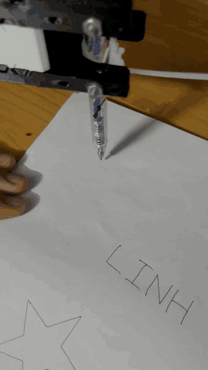
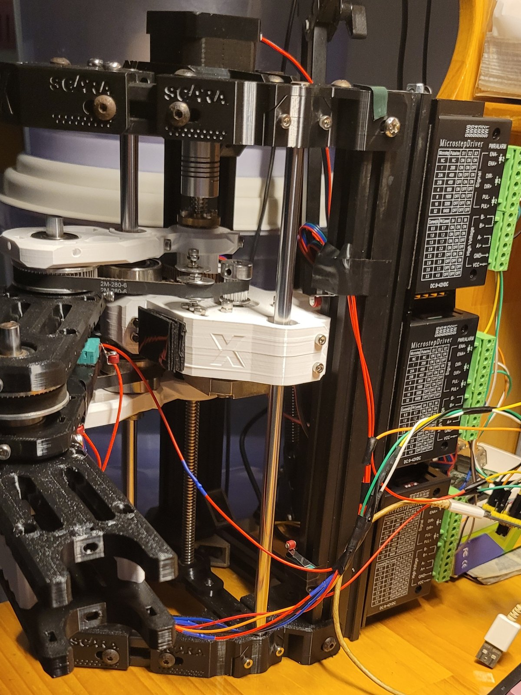
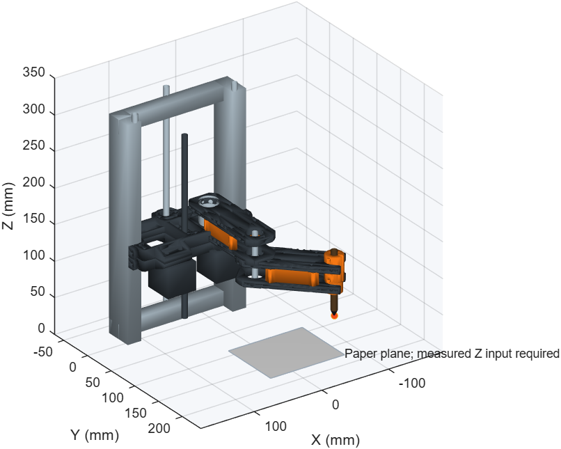
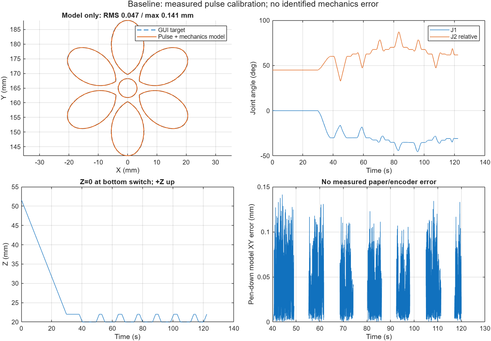
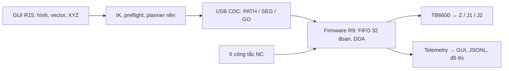

<div align="center">

# SCARA Drawing Robot

**Robot vẽ 2R + Z trên cơ khí X-SCARA · GUI R15 · Firmware R9**

Python/Tkinter · STM32F103C8 / Zephyr · MATLAB/Simulink · Webots

[](LICENSE)


&nbsp;


<sub>Ảnh và video robot thực từ các lần chạy trước. [Video gốc](media/drawing-demo.mp4)</sub>

**[Tiếng Việt](#tiếng-việt)** · **[English](#english)**

</div>

# Tiếng Việt

Project môn **HPMR, học kỳ HK261**: điều khiển robot SCARA vẽ hình và chữ trên giấy.
Khung và tay dùng thiết kế [madl3x/x-scara](https://github.com/madl3x/x-scara);
phần phát triển trong project gồm firmware, GUI, mô phỏng và giá kẹp bút Deli EG118.

## Theo dõi branch này

Branch: **`codex/scara-r15-upgrade-20261017`**.
Bản nâng cấp ban đầu: [`4a8317a`](https://github.com/TuanLinh05/SCARA-Robot/commit/4a8317ae81dedec2ba4cc48bac335332e0eb9d4c), ngày **17/10/2026**.

| Thành phần | Trạng thái trên branch |
| --- | --- |
| GUI | R15, chạy từ mã nguồn Python; có chế độ demo |
| Firmware | Nhãn `SCARA_CART_NC_HOME_V5_R9`, protocol 5; có thêm thay đổi mã nguồn trên branch |
| MATLAB/Simulink | Mô hình stepper `scara_stepper.slx`, dùng snapshot hiệu chuẩn từ log |
| Webots | Mô hình vật lý nghiên cứu riêng; tham số chưa đồng bộ với hiệu chuẩn robot thực |
| Đóng gói EXE | Script/spec vẫn mang tên R14; chưa kiểm chứng lại bản đóng gói R15 |

**Đọc nhanh:** [Thay đổi](#các-thay-đổi-chính) · [Chạy GUI](#chạy-gui) ·
[Vận hành](#quy-trình-vẽ) · [Mô phỏng](#mô-phỏng) ·
[Kiểm thử](#kiểm-thử) · [Đọc mã](#cấu-trúc-và-điểm-vào-mã-nguồn).

## Các thay đổi chính

| Nhóm | Nội dung | Mã nguồn để theo dõi |
| --- | --- | --- |
| Giao diện R15 | Chuyển giữa khung 2D/3D, cửa sổ 3D riêng, xoay/dịch/zoom và xuất SVG; 6 thẻ thông số và 6 đèn công tắc | [3D](Software/src/cartesian_nc_3d.py), [layout](Software/src/cartesian_nc_layout.py), [view](Software/src/cartesian_nc_view.py) |
| Điều khiển | Step-jog, tư thế nhanh, điều chỉnh tốc độ và HOME nhanh sau khi đã hiệu chuẩn | [editor](Software/src/cartesian_nc_editor.py), [motion](Software/src/cartesian_nc_motion.py) |
| Vẽ và nhập file | Chữ nét đơn A–Z/0–9, mẫu SPIRAL/GRID/ROSE/POLYGON, SVG/DXF/G-code, sắp xếp nét và lập quỹ đạo nền | [font](Software/src/cartesian_nc_font.py), [vector](Software/src/cartesian_nc_vector.py), [planning](Software/src/cartesian_nc_planning.py) |
| Hiệu chuẩn | Ước lượng/bù độ rơ, hiệu chuẩn góc công tắc bằng 2 điểm, mặt phẳng giấy bằng 3 điểm | [calibration](Software/src/cartesian_nc_calibration.py), [model](Software/src/cartesian_nc_model.py) |
| Dữ liệu | Đồ thị tọa độ, góc khớp, tốc độ/xung/FIFO; đọc log JSONL và xuất CSV/SVG/Markdown | [analytics](Software/src/cartesian_nc_analytics.py), [audit](Software/src/cartesian_nc_audit.py) |
| Firmware | HOME đầy đủ/nhanh, xử lý ghép đai, bù độ rơ và telemetry; truyền đoạn theo ACK và dung lượng FIFO | [core](Firmware/ScaraCartesian/src/cart_core.c), [commands](Firmware/ScaraCartesian/src/cart_commands.c), [upload](Software/src/cartesian_nc_path.py) |
| Mô phỏng và dọn nguồn | MATLAB chuyển từ PID/động lực học sang tái hiện số xung của planner; cập nhật controller Webots; bỏ `Firmware/Ref` và các ví dụ/mô hình MATLAB cũ | [Simulation](Simulation/README.md), [MATLAB](Simulation/matlab/README.md) |

Khung 3D trong GUI là mô hình hiển thị giản lược, có tham chiếu kích thước STL.
Telemetry và vị trí hiển thị được suy ra từ số xung; robot thực chưa có encoder.

## Chạy GUI

Các lệnh PowerShell dưới đây chạy từ **thư mục gốc repository**, nơi có README này.
Môi trường đã kiểm thử: **Python 3.12**, Tkinter và `pyserial`.

### Chạy demo trước

```powershell
python -m pip install -r Software/requirements.txt
python Software/src/cartesian_nc_control.py --demo
```

Demo dùng robot giả lập trong phần mềm, không mở cổng COM thật.

### Kết nối robot thực

```powershell
python Software/src/cartesian_nc_control.py
```

Trên Windows có thể mở [`Software/Run_Cartesian_GUI.bat`](Software/Run_Cartesian_GUI.bat)
sau khi cài các phụ thuộc. Launcher ưu tiên chạy mã nguồn Python.

Nếu có EXE cũ trong `Software/dist/`, dùng lệnh chạy nguồn ở trên để xem các thay đổi
R15. Điểm vào đóng gói là [`Build_Cartesian_NC_GUI.ps1`](Software/Build_Cartesian_NC_GUI.ps1);
script và spec hiện vẫn dùng tên `SCARA_Cartesian_NC_v5_R14`.

## Quy trình vẽ

1. Kết nối COM, kiểm tra **Cài đặt & Cơ khí**: chiều dài khâu, bước vít me,
   vi bước driver, tỷ số truyền, chiều DIR và góc công tắc.
2. Chạy **HOME / CALIB** để lấy mốc và hiệu chuẩn đầy đủ. **HOME Nhanh** dùng lại
   hành trình đã hiệu chuẩn trong bộ nhớ firmware; khi chưa có dữ liệu, firmware
   thực hiện HOME đầy đủ.
3. Dùng XYZ hoặc **Jog & Tùy biến** để rà bút. Lấy và xác nhận **Z giấy**.
   Khi cần, dùng wizard để hiệu chuẩn góc công tắc hoặc mặt phẳng giấy.
4. Mở **Thư viện hình & chữ**: chọn mẫu, nhập chữ hoặc nạp vector; chỉnh kích thước,
   tâm, góc xoay và xem trước đường chạy.
5. Chạy thử trên không trước, sau đó vẽ thật. Bộ lập quỹ đạo kiểm tra toàn bộ nét,
   nâng bút khi chuyển nét và khi hoàn tất.
6. Dùng **Đồ thị & Báo cáo** để quan sát telemetry hoặc xuất dữ liệu.
   Sau Dừng/Esc, lỗi kết nối/biên hoặc nhả arm làm mất mốc, cần HOME lại.

Hướng dẫn giao diện: [Software/README.md](Software/README.md).
Phân tích nét vẽ đã ghi: [drawing_audit_20261008.md](Software/reports/drawing_audit_20261008.md).

## Phần cứng và cấu hình

| Mục | Cấu hình tham chiếu |
| --- | --- |
| Cơ cấu | 2 khớp quay J1/J2 + trục Z tịnh tiến |
| Khâu và đầu bút | L1 = L2 = 98 mm; lệch TCP mặc định bằng 0, cần đo theo cụm lắp |
| Truyền động | Đai 2GT cho tay; vít me Z, bước dẫn cấu hình 2 mm/vòng |
| Động cơ và driver | 3 × NEMA 17, 3 × TB6600, STEP/DIR/ENA |
| Vi điều khiển | STM32F103C8, USB CDC, firmware Zephyr 3.7 |
| Công tắc | 6 công tắc COM-NC, hai biên mỗi trục |
| Giấy tham chiếu | 100 × 100 mm |

Cấu hình GUI nằm ở [Software/cartesian_nc_config.json](Software/cartesian_nc_config.json).
Thứ tự các mảng trục là **[Z, J1, J2]**. Cấu hình hiện tại dùng vi bước
`[16, 16, 8]`, tỷ số truyền J1/J2 `[3, 9]` và `coupling = 0.333333`;
phải đối chiếu với driver và cơ khí thực tế.

Phân biệt hệ số ghép **góc** `k` và hệ số ghép **xung** `β`:

```text
A = q1
B = q2 + k*q1
β = k*F2/F1
```

`q2` là góc khuỷu tương đối; `F1/F2` là số xung trên độ của từng trục.
Giá trị snapshot MATLAB là dữ liệu của lần chạy đã ghi, có thể khác cấu hình GUI hiện tại.
Không chép mặc định một hệ số giữa các bộ cấu hình.

### Đấu dây và firmware

TB6600 nối chung âm: PUL−, DIR−, ENA− về GND chung.

| Trục | PUL+ | DIR+ | ENA+ | Biên DIR HIGH | Biên DIR LOW |
| --- | --- | --- | --- | --- | --- |
| Z | PA0 | PA1 | PA2 | PA3, trên | PA4, dưới |
| J1 | PA8 | PB15 | PB14 | PB0 | PB1 |
| J2 | PA6 | PA7 | PB13 | PB10 | PB11 |

COM công tắc về GND, NC về GPIO kéo lên 3,3 V. Bình thường LOW; chạm công tắc
hoặc hở dây là HIGH. Chiều DIR phải khớp cấu hình `positive_high`.

Bộ HEX/BIN có sẵn trong [Firmware/ScaraCartesian/Hex](Firmware/ScaraCartesian/Hex),
nạp tại `0x08000000` qua ST-LINK. Nhãn R9 được giữ lại trên branch; chỉ nhãn phiên bản
không xác nhận binary khớp mọi thay đổi mã nguồn. Lần kiểm thử bên dưới chưa build lại
firmware cho MCU hoặc nạp vào robot.

Build nguồn cần workspace Zephyr, SDK, CMake và Ninja.
Script [build.ps1](Firmware/ScaraCartesian/tools/build.ps1) nhận
`-ZephyrRoot`, `-SdkRoot`, `-Python`, `-BuildDirectory`, `-SkipExport`.
Dùng `-SkipExport` khi muốn build riêng mà chưa ghi đè bộ HEX/BIN.
Xem thêm [hướng dẫn firmware](Firmware/ScaraCartesian/README.md).

BOM/in 3D: [tay](Hardware/arm/BOM.md) · [khung](Hardware/frame/BOM.md) ·
[danh sách in](Hardware/3D%20Print/README.md) · [giá kẹp EG118](Hardware/Pen_Holder_EG118).

## Mô phỏng

| Môi trường | Vai trò và nguồn tham số | Điểm mở |
| --- | --- | --- |
| MATLAB/Simulink | Tái hiện số xung DDA từ planner GUI, quy đổi động học, khảo sát NC/watchdog và sai lệch giả định; snapshot ở `matlab/config/robot_calibration.json` | [scara_stepper.slx](Simulation/matlab/simulink/models/scara_stepper.slx) |
| Webots | Nghiên cứu vật lý, PID và tiếp xúc bút/giấy với các giá trị ước lượng; dùng `common/config/scara.json` | [scara_draw.wbt](Simulation/webots/worlds/scara_draw.wbt) |

Hai môi trường hiện có bộ tham số khác nhau. Kết quả Webots và fixture đối chiếu cũ
không xác nhận mô hình stepper mới hoặc độ chính xác robot thực.

### MATLAB/Simulink

Đặt Current Folder ở `Simulation/matlab`. Cần MATLAB, Simulink để chạy mô hình,
và Python có thể truy cập mã nguồn Software trong cùng repository.
Không cần Robotics System Toolbox hay Simscape Multibody.

```matlab
run_scara                         % Giao diện 3D và chọn mẫu
startup_scara;
out = scara_simulink('flower');    % Chạy mô hình stepper
validate_scara;                   % Kiểm thử MATLAB/Simulink
```

Mô hình dùng các khối Simulink chuẩn. Không còn bộ mô phỏng PID/động lực học MATLAB
cũ trong branch này. Xem [hướng dẫn MATLAB](Simulation/matlab/README.md).

<div align="center">

&nbsp;

<br><sub>Ảnh kết quả mô phỏng đã lưu trong repository.</sub>
</div>

### Webots

Mở `Simulation/webots/worlds/scara_draw.wbt`, nhấn **Run**.
Sửa [demo.json](Simulation/webots/config/demo.json), rồi Reset/Reload để đổi mẫu/chế độ.
World lưu theo định dạng R2025a; runtime Webots chưa được kiểm chứng lại trong lần
kiểm thử branch này. Xem [hướng dẫn Webots](Simulation/webots/README.md).

## Cấu trúc và điểm vào mã nguồn

```text
.
├── Firmware/ScaraCartesian/
│   ├── src/                 Core, HOME, DDA, lệnh, telemetry, GPIO/timer
│   ├── tests/               Harness C và kiểm thử artifact
│   ├── tools/               Build, verify, kiểm tra HEX/BIN
│   └── Hex/                 Bộ firmware và báo cáo có sẵn
├── Software/
│   ├── src/                 GUI R15, mô hình, planner, vector, 3D, hiệu chuẩn, log
│   ├── tests/               Unit test và GUI smoke test bằng cổng giả lập
│   ├── packaging/           Spec PyInstaller, hiện còn tên R14
│   └── reports/             Báo cáo kiểm thử và phân tích log
├── Simulation/
│   ├── matlab/              config/, src/, simulink/, tests/, tools/, output/
│   ├── webots/              World, PROTO, controller, tests
│   └── common/              Cấu hình/asset/CSV phục vụ Webots
├── Hardware/                STL, BOM, hướng dẫn lắp, giá kẹp EG118
├── Doc/                     Đánh giá firmware và sai lệch nét vẽ
├── media/                   Ảnh và video robot thực
├── tools/                   Công cụ PowerShell dùng chung
└── Verify_SCARA.ps1         Kiểm thử firmware trước, rồi software
```

Luồng điều khiển chính:



Bắt đầu đọc từ [cartesian_nc_control.py](Software/src/cartesian_nc_control.py)
và [main.c](Firmware/ScaraCartesian/src/main.c).
Planner/USB chạy phía PC; firmware phát xung bằng timer và kiểm tra bảo vệ.
Giới hạn mềm, NC, heartbeat 350 ms, USB, GPIO và cạn bộ đệm được xử lý trong firmware.

## Kiểm thử

Chạy từ thư mục gốc; cần **Python và GCC** cho harness firmware.
Các lệnh này dùng cổng/ngoại vi giả lập, không điều khiển robot thực.

```powershell
# Firmware C + artifact tests + toàn bộ unit test software
powershell -NoProfile -ExecutionPolicy Bypass -File .\Verify_SCARA.ps1

# Thêm 6 kịch bản GUI smoke test
powershell -NoProfile -ExecutionPolicy Bypass -File .\Verify_SCARA.ps1 -Gui

# Webots offline, không cần cài Webots
python -m unittest discover -s Simulation/webots/tests -v
```

Có thể truyền `-Python` và `-Gcc` cho `Verify_SCARA.ps1` khi công cụ không có trên PATH.
Build/cache/log được tạo trong các thư mục đã bỏ qua bằng Git.

Kết quả kiểm tra **17/10/2026**, trên mã nguồn commit `4a8317a`:

| Phạm vi | Kết quả |
| --- | --- |
| Harness C: core, protocol, GPIO/timer ISR | 3 chương trình kiểm thử đạt |
| Kiểm thử công cụ firmware artifact | 6/6 đạt |
| Unit test software | 78/78 đạt |
| GUI smoke test, gồm R15 và wizard hiệu chuẩn | 6/6 kịch bản đạt |
| Webots offline | 14/14 đạt |
| MATLAB/Simulink | Chưa chạy lại; [báo cáo lưu sẵn](Simulation/matlab/output/validation/validation.json) thuộc lần kiểm tra trước |
| MCU/robot thực và đóng gói EXE | Chưa kiểm chứng lại trong lần này |

## Giới hạn cần hiểu khi đọc kết quả

- Số xung phát ra không chứng minh motor/bút đã đến đúng vị trí. Độ rơ, trượt bước,
  sai chiều dài khâu, góc công tắc và độ võng bút vẫn cần đo trên phần cứng.
- Bù độ rơ và hiệu chuẩn 2/3 điểm là các công cụ hỗ trợ; kiểm thử phần mềm chưa xác nhận
  mức cải thiện nét vẽ thực tế của branch R15.
- Dữ liệu MATLAB là tái hiện offline theo snapshot. Khối độ rơ/độ trễ là kịch bản
  khảo sát, không phải thông số cơ khí đã đo; không mô phỏng chi tiết điện driver.
- Các bộ đọc SVG/DXF/G-code nằm trong [cartesian_nc_vector.py](Software/src/cartesian_nc_vector.py).
  Cần xem trước và preflight file nhập; không coi đây là bộ CAD/CAM hỗ trợ mọi thực thể.
- Một số README thành phần còn giữ mô tả phiên bản trước. Bảng thay đổi, cấu trúc
  và kết quả kiểm thử ở README gốc này mô tả trạng thái branch đã nêu.

Tài liệu phân tích: [đánh giá firmware](Doc/Danh_gia_Firmware_SCARA.md) ·
[tổng quan mô phỏng](Simulation/README.md).

# English

This HPMR/HK261 project controls a **2R + Z SCARA pen plotter** based on X-SCARA
mechanics. This branch, `codex/scara-r15-upgrade-20261017`, contains the **R15
Python GUI**, firmware source retaining the **R9/protocol 5** identifier, and revised simulation tools.

## Branch highlights

- **GUI:** 2D/3D views, a separate 3D window, step-jog, quick poses, six metric
  cards and six limit-switch indicators.
- **Drawing:** single-stroke A–Z/0–9 text, parametric patterns, SVG/DXF/G-code
  import, stroke ordering and background planning.
- **Calibration and data:** backlash tools, two-point switch-angle calibration,
  three-point paper-plane fitting, telemetry plots and CSV/SVG/Markdown export.
- **Firmware:** full/quick homing, belt coupling, backlash handling, diagnostics
  and ACK/FIFO-aware trajectory upload.
- **Simulation:** MATLAB now replays planner step counts using
  `scara_stepper.slx`. Webots remains a separate physics/PID research model
  with its own estimated parameters.
- **Cleanup:** the legacy `Firmware/Ref` project and old MATLAB PID examples/models
  were removed.

## Quick start

Run these PowerShell commands from the repository root with Python 3.12:

```powershell
python -m pip install -r Software/requirements.txt
python Software/src/cartesian_nc_control.py --demo
```

For hardware, run the same GUI command without `--demo`. Check mechanics and
driver settings, perform **HOME / CALIB**, establish paper Z, preview the drawing,
then dry-run before drawing. Quick HOME reuses calibration retained in firmware
memory; without prior calibration it performs a full HOME.

The Windows launcher is [Run_Cartesian_GUI.bat](Software/Run_Cartesian_GUI.bat).
Packaging scripts still use R14 names; an R15 EXE has not been validated.

For MATLAB, open `Simulation/matlab` and run `run_scara`; MATLAB, Simulink and
Python are required to run the stepper model. For Webots, open
`Simulation/webots/worlds/scara_draw.wbt`. See the
[simulation overview](Simulation/README.md) for the different parameter sources.

## Validation and limits

On **17 October 2026**, source commit `4a8317a` passed three C host test programs,
six firmware artifact-tool tests, **78 software unit tests**, **six GUI smoke
scenarios**, and **14 offline Webots tests**. Use `Verify_SCARA.ps1 -Gui` and the
Webots unittest command in the [testing section](#kiểm-thử) to repeat them.

MATLAB, the Webots runtime, MCU builds, physical drawing and EXE packaging were
not revalidated in that run. Prebuilt firmware retains the R9 name; check or
rebuild it before assuming it matches every source change.

The robot is open-loop. Displayed positions and telemetry are based on step
counts, not physical encoder feedback. Software tests and offline simulation
do not establish pen accuracy on paper. The GUI's simplified 3D view is a
visual aid, with dimensions referenced from the STL assets.

## Nguồn và giấy phép / Credits and license

- Khung, tay, STL, BOM và ảnh lắp ráp / frame and arm design:
  [madl3x/x-scara](https://github.com/madl3x/x-scara), GPL-3.0.
  Source revision recorded in this project: `3c7c17e3dc0805b41a3cac6d4cd2778d585d7ed2`.
- Nguồn mesh / mesh provenance:
  [Simulation/common/assets/manifest.json](Simulation/common/assets/manifest.json).
- Giá kẹp bút / pen-holder attribution:
  [Hardware/Pen_Holder_EG118/NOTICE.txt](Hardware/Pen_Holder_EG118/NOTICE.txt).

Repository license: **[GNU GPL v3.0](LICENSE)**.

<div align="center">
Tác giả / Author: <a href="https://github.com/TuanLinh05">@TuanLinh05</a> · HK261
</div>